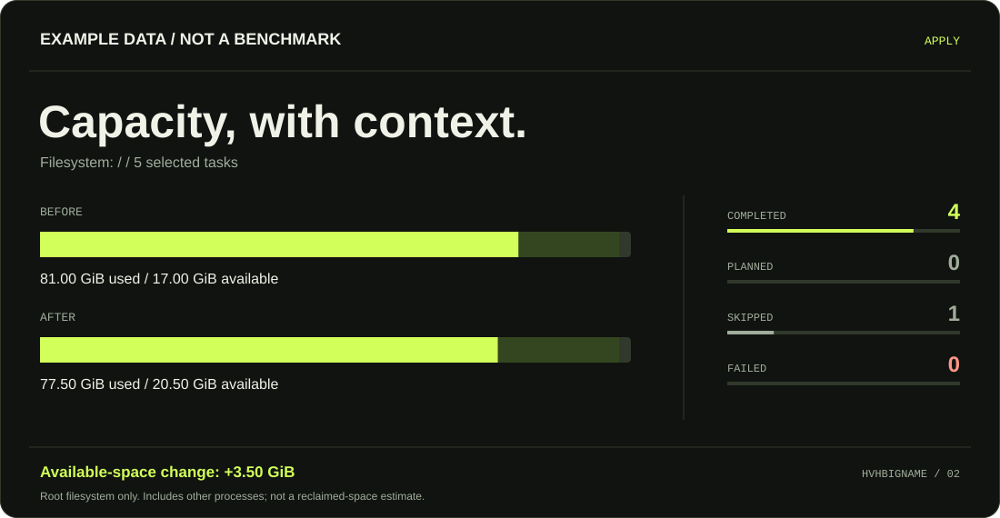

<picture>
  <source media="(prefers-color-scheme: light)" srcset="./docs/assets/hero-light.svg">
  
</picture>

<p align="center">
  <a href="#quick-start">Install</a> &nbsp; / &nbsp;
  <a href="#maintenance">Tasks</a> &nbsp; / &nbsp;
  <a href="#compatibility">Platforms</a> &nbsp; / &nbsp;
  <a href="#reports">Reports</a> &nbsp; / &nbsp;
  <a href="./README.md">Русский ↗</a>
</p>

### Server Cleaner / v2

Predictable server maintenance in one standalone **POSIX `sh`** script.
Preview native commands, choose your tasks, then get an honest result.
English / Russian UI, an interactive menu, non-interactive execution and JSON reports.
No Python, Node.js or `jq` dependency for cleanup itself.

## Quick start

```sh
curl -fsSL https://raw.githubusercontent.com/HVHBIGNAME/server-cleaner/main/install.sh | sh
```

Or use `wget`:

```sh
wget -qO- https://raw.githubusercontent.com/HVHBIGNAME/server-cleaner/main/install.sh | sh
```

Installs to `~/.local/bin` for regular users or `/usr/local/bin` for root.
The installer prints the full command path, verifies SHA-256 and shell syntax,
and stages each replacement before renaming it into place. Installation does not run cleanup.

```sh
server-cleaner                              # Interactive menu
server-cleaner --dry-run                    # Default: preview only
server-cleaner --list                       # Tools and task availability
sudo "$(command -v server-cleaner)" --apply  # Confirm and run maintenance
```

If `~/.local/bin` is not on `PATH`, use `"$HOME/.local/bin/server-cleaner"` or add
`export PATH="$HOME/.local/bin:$PATH"` to your shell configuration.

For a system-wide install, pipe the installer to `sudo sh -s -- --system`.
For offline installation, run `sh install.sh --from "$PWD"` from a checkout.
Use `--prefix /absolute/path` for a custom installation. To pin a version, download
`install.sh` from a full commit SHA and pass that same SHA with `--ref`.
Checksums verify bundle integrity, not a separate cryptographic signature.

## Maintenance

| Task | Action | Default? |
| :-- | :-- | :-- |
| `packages` | Native package-cache cleanup; installed packages stay installed | Yes |
| `journal` | Vacuum archived systemd journals older than 14 days | Yes |
| `temp` | `systemd-tmpfiles --clean` for `/tmp` and `/var/tmp`, using OS age policies | Yes |
| `logs` | Normal `logrotate` / `newsyslog` processing according to OS configuration | Yes |
| `coredumps` | Native tmpfiles age policies for core dumps | Yes |
| `docker` | Unused build cache of a local Docker engine | Opt-in |
| `history` | Your own saved Bash / Zsh / Fish / Vim / Less / Nano history files | Opt-in |

```sh
server-cleaner --only packages,journal --keep-days 30
sudo "$(command -v server-cleaner)" --only packages,journal --keep-days 30 --apply
server-cleaner --only docker --keep-days 7 --apply
server-cleaner --only history --apply
```

`--keep-days` accepts **1..3650**, default **14**, for journal, Docker and Homebrew.
Other tasks follow their native policies. Unsupported tools produce `skipped` results.
Permission or unsafe-path failures in preflight prevent execution. Native command failures
remain visible and result in a nonzero exit status.

Active logs, audit logs, login records and Docker JSON logs are not truncated. Docker
cleanup keeps images, containers and volumes; remote endpoints are skipped. Open shells
keep their in-memory history and may write it back later. Execute this script; do not source it.

## Compatibility

Native package-cache adapters: **APT, DNF5, DNF, microdnf, YUM, Zypper, paccache/Pacman,
APK, XBPS, eclean-pkg, eopkg, Homebrew and FreeBSD pkg**.

[CI](https://github.com/HVHBIGNAME/server-cleaner/actions/workflows/ci.yml) covers Ubuntu 24.04
(x86-64 / ARM64), Debian 12/13, Alpine 3.22, Fedora 43, Rocky 9, UBI 9 minimal,
Arch Linux, openSUSE Leap 16, macOS and FreeBSD 14.3. Linux containers and the FreeBSD VM
also execute real package-cache cleanup. Containers do not simulate every booted OS service.

Void, Gentoo and Solus adapters have isolated command tests. OpenBSD / NetBSD have limited
capability-based support without native CI or a package-cache adapter. Nix/Guix stores and
immutable-image maintenance have no specialized adapters. Windows requires a Linux distribution
inside WSL; native PowerShell and Git Bash are not supported.

## Reports

<picture>
  <source media="(prefers-color-scheme: light)" srcset="./docs/assets/report-light.svg">
  
</picture>

<sub>Illustrative data from <a href="./docs/example-report.json">example-report.json</a>, not a measured benchmark.</sub>

```sh
server-cleaner --json > plan.json
sudo "$(command -v server-cleaner)" --apply --yes --json > report.json
# From a project checkout; requires Python 3.9+, no third-party packages
python3 tools/render_report.py report.json --theme dark > report.svg
```

JSON includes `schema_version`, task commands / results, a summary and disk snapshots in KiB.
The chart measures **`/` only** and includes concurrent activity. Separate `/var` or home
filesystems may change without affecting it. Missing measurements are `null`; previews do not
claim an after-cleanup result. Native output goes to stderr. Early fatal errors may have no JSON.

Exit codes: `0` success (possibly with skips), `1` operation / preflight failure, `2` invalid usage
or missing confirmation, `3` unsupported platform / missing base tool, `75` lock contention,
`130` / `143` interruption.

## Automation and removal

Non-interactive cleanup requires `--apply --yes`. `--quiet` reduces UI output without hiding
errors. `--no-color` / `NO_COLOR` disable ANSI; `--lang en|ru` selects the language.

```sh
# Optional daily maintenance at 03:17 server time; requires installed, running cron
curl -fsSL https://raw.githubusercontent.com/HVHBIGNAME/server-cleaner/main/install.sh | sudo sh -s -- --system --schedule daily

# Migrate the CURRENT user's v1 installation and exact original cron line
curl -fsSL https://raw.githubusercontent.com/HVHBIGNAME/server-cleaner/main/install.sh | sh -s -- --migrate-legacy --yes

server-cleaner-agents                       # Read-only guest / cloud package inventory
server-cleaner-uninstall --yes              # Current installation
sudo /usr/local/bin/server-cleaner-uninstall --yes  # System installation
```

Reinstall to update v2. The installer preserves the current binaries on download / integrity
failures. Cron updates affect only the matching marked block; unrelated entries are kept.
Custom v1 cron commands must be reviewed manually. Uninstallation never runs final cleanup.

Run locks live in `${XDG_STATE_HOME:-$HOME/.local/state}/server-cleaner/lock`. Use a consistent
state directory for each account. SIGKILL or power loss can leave a stale lock: verify its PID
and that no cleaner is running before removing it.

**v2 changes:** installer `--silent` means quiet output only; `anti-monitoring.sh` is now a
read-only inventory, available as `server-cleaner-agents`. Bulk cloud / guest agent removal
and full log wiping have been replaced by normal system maintenance.

See [CONTRIBUTING.md](./CONTRIBUTING.md) for tests and [CHANGELOG.md](./CHANGELOG.md) for migration details.

**[HVHBIGNAME](https://github.com/HVHBIGNAME)** · Small tools. Clear intent. · [MIT](./LICENSE)
