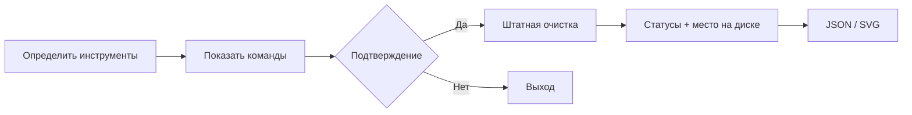

<picture>
  <source media="(prefers-color-scheme: light)" srcset="./docs/assets/hero-light.svg">
  
</picture>

<p align="center">
  <a href="#quick-start">Установка</a> &nbsp; / &nbsp;
  <a href="#maintenance-map">Возможности</a> &nbsp; / &nbsp;
  <a href="#system-coverage">Совместимость</a> &nbsp; / &nbsp;
  <a href="#run-report">Графики</a> &nbsp; / &nbsp;
  <a href="./README.en.md">English ↗</a>
</p>

<p align="center">
  <a href="https://github.com/HVHBIGNAME/server-cleaner/actions/workflows/ci.yml"></a>
  <a href="./LICENSE"></a>
  
</p>

### Server Cleaner / v2

Небольшой инструмент для предсказуемого обслуживания сервера: кеш пакетов,
старые журналы, временные файлы и дампы. **Сначала показывает план, затем выполняет
выбранные действия и объясняет результат.**

Один самостоятельный `sh`-скрипт. Русский и английский интерфейс. Работа в SSH,
минимальных контейнерах и автоматизации. Для самой очистки не нужны Python, Node.js или `jq`.

## Quick start

**Установка одной командой:**

```sh
curl -fsSL https://raw.githubusercontent.com/HVHBIGNAME/server-cleaner/main/install.sh | sh
```

Или через `wget`, в том числе в Alpine:

```sh
wget -qO- https://raw.githubusercontent.com/HVHBIGNAME/server-cleaner/main/install.sh | sh
```

У обычного пользователя команды устанавливаются в **`~/.local/bin`**, у root —
в **`/usr/local/bin`**. Установщик выводит полный путь для запуска, проверяет SHA-256
и синтаксис скачанных файлов перед заменой. Установка сама по себе ничего не очищает.

```sh
server-cleaner                              # Простое меню в терминале
server-cleaner --dry-run                    # Показать стандартный план
server-cleaner --list                       # Все действия и доступные инструменты
sudo "$(command -v server-cleaner)" --apply  # Выполнить план с подтверждением
```

Если `~/.local/bin` ещё нет в `PATH`, запускайте `"$HOME/.local/bin/server-cleaner"`
или добавьте `export PATH="$HOME/.local/bin:$PATH"` в настройки своей оболочки.

<details>
<summary><b>Системная установка, offline и фиксированная версия</b></summary>

Для установки в `/usr/local/bin` от обычного пользователя:

```sh
curl -fsSL https://raw.githubusercontent.com/HVHBIGNAME/server-cleaner/main/install.sh | sudo sh -s -- --system
```

Из локального checkout, без скачиваний и установки зависимостей:

```sh
git clone https://github.com/HVHBIGNAME/server-cleaner.git
cd server-cleaner
sh install.sh --from "$PWD"
```

Произвольный префикс:

```sh
sh install.sh --from "$PWD" --prefix "$HOME/tools"
```

Для воспроизводимого развёртывания замените `COMMIT_SHA` полным хешем коммита:

```sh
curl -fsSL https://raw.githubusercontent.com/HVHBIGNAME/server-cleaner/COMMIT_SHA/install.sh | sh -s -- --ref COMMIT_SHA
```

Все файлы и `SHA256SUMS` загружаются из одного ref. Проверка обнаруживает неполные
или несовпадающие загрузки; это проверка целостности, а не отдельная цифровая подпись.

</details>

## Maintenance map

| Действие | Что выполняется | Политика |
| :-- | :-- | :-- |
| `packages` | Штатная очистка кеша найденного пакетного менеджера | По умолчанию; установленные пакеты сохраняются |
| `journal` | `journalctl --vacuum-time=14d` | Только архивные журналы; срок задаётся `--keep-days` |
| `temp` | `systemd-tmpfiles --clean` для `/tmp` и `/var/tmp` | Возраст и исключения из конфигурации ОС |
| `logs` | `logrotate /etc/logrotate.conf` или `newsyslog` | Плановая ротация по конфигурации, без `--force` |
| `coredumps` | `systemd-tmpfiles --clean` для дампов | Возрастные правила ОС |
| `docker` | Неиспользуемый кеш сборки локального Docker | Только через `--only docker`; срок — `--keep-days` |
| `history` | Сохранённые файлы Bash, Zsh, Fish, Vim, Less и Nano своего пользователя | Только через `--only history` |

**Выбирайте конкретные действия:**

```sh
# Посмотреть план для кеша пакетов и старого журнала
server-cleaner --only packages,journal --keep-days 30

# Выполнить именно этот план
sudo "$(command -v server-cleaner)" --only packages,journal --keep-days 30 --apply

# Кеш сборки Docker старше недели
server-cleaner --only docker --keep-days 7 --apply

# Собственные сохранённые файлы истории, без sudo
server-cleaner --only history --apply
```

`--keep-days` принимает целое число **от 1 до 3650**, по умолчанию — **14**.
Для `journal`, `docker` и Homebrew он задаёт срок хранения. Для временных файлов,
дампов и текстовых логов действуют правила самой системы.

### Что происходит при выполнении



- Нет подходящего инструмента → **`skipped`** с объяснением.
- Неверные права или небезопасный путь обнаружены в плане → выполнение не начинается.
- Штатная команда завершилась с ошибкой → **`failed`**, её вывод виден, код выхода ненулевой.
- Одновременный запуск с тем же каталогом состояния → блокировка, код **75**.

Очистка не обнуляет активные системные логи, audit, историю входов или Docker JSON logs.
Кеш Docker очищается без удаления образов, контейнеров и volumes. Удалённые Docker
endpoint пропускаются. Сохранённая история и история в памяти открытого shell — разные вещи:
оболочка может снова записать свой буфер при завершении. Запускайте скрипт как программу,
а не через `source`.

## System coverage

Выбор действий зависит от **реально доступных команд**, а не только от названия дистрибутива.
`systemd` и `sudo` не обязательны для запуска: необходимые привилегии получает сам вызывающий
пользователь, а отсутствующие возможности явно пропускаются.

| Семейство | Кеш пакетов | Проверки |
| :-- | :-- | :-- |
| Debian / Ubuntu и производные | `apt-get` | Debian 12/13, Ubuntu 24.04; x86-64 и Ubuntu ARM64 в CI |
| Fedora / RHEL / Rocky / AlmaLinux | `dnf5`, `dnf`, `microdnf`, `yum` | Fedora 43, Rocky 9, UBI 9 minimal в CI |
| Alpine | `apk` | Alpine 3.22 / BusyBox `ash` в CI |
| Arch / Manjaro и производные | `paccache`, иначе `pacman` | Arch Linux в CI |
| openSUSE / SLES | `zypper` | openSUSE Leap 16 в CI |
| Void | `xbps-remove` | Адаптер проверяется изолированными тестами |
| Gentoo | `eclean-pkg` из `gentoolkit` | Адаптер проверяется изолированными тестами |
| Solus | `eopkg` | Адаптер проверяется изолированными тестами |
| macOS | Homebrew от обычного пользователя | Системный `sh`, BSD-утилиты и native preview в CI |
| FreeBSD | `pkg` | FreeBSD 14.3 VM, включая очистку кеша, в CI |
| OpenBSD / NetBSD | Отдельного адаптера кеша нет | Общий CLI, история и доступный `newsyslog`; native CI пока нет |
| Windows | Через WSL с Linux-дистрибутивом | Нативный PowerShell / Git Bash не поддерживается |

Контейнерная матрица проверяет CLI, установку/удаление, регрессии и реальную очистку кеша
пакетов. Она не заменяет проверку всех сервисов в загруженной ОС. Nix/Guix store,
immutable-образы и произвольные сторонние менеджеры пакетов не очищаются специальными адаптерами.

**[Открыть матрицу и результаты GitHub Actions ↗](https://github.com/HVHBIGNAME/server-cleaner/actions/workflows/ci.yml)**

## Run report

После выполнения — статусы действий и полосы заполнения корневой файловой системы.
Для автоматизации есть JSON, для документации и дашбордов — локальный SVG-генератор.

<picture>
  <source media="(prefers-color-scheme: light)" srcset="./docs/assets/report-light.svg">
  
</picture>

<sub>Иллюстрация из <a href="./docs/example-report.json">example-report.json</a>. Значения вымышлены для демонстрации формата. В собственном отчёте используются данные вашего запуска.</sub>

```sh
# JSON плана: ничего не меняет
server-cleaner --json > plan.json

# JSON реального выполнения; вывод системных команд остаётся в stderr
sudo "$(command -v server-cleaner)" --apply --yes --json > report.json

# Из каталога проекта; нужен только Python 3.9+, без pip-зависимостей
python3 tools/render_report.py report.json --theme dark > report.svg
python3 tools/render_report.py report.json --theme light > report-light.svg
```

График показывает файловую систему **`/`**, а не суммарное место на всех дисках.
Изменение свободного места включает параллельную активность других процессов.
Если `/var` или `$HOME` находятся на отдельном разделе, их очистка может не изменить этот график.
Это наблюдение «до/после», а не обещание освободить определённый объём.

<details>
<summary><b>Формат JSON и коды выхода</b></summary>

- `schema_version`: версия структуры отчёта, сейчас `1`.
- `tasks[]`: идентификатор, статус, объяснение, необходимость root и команда как массив аргументов.
- `summary`: `completed`, `planned`, `skipped`, `failed`.
- `disk.before` / `disk.after`: `size_kib`, `used_kib`, `available_kib` в KiB; `null`, если измерения нет.
- `disk.available_delta_kib`: изменение доступного места; в предварительном просмотре — `null`.

| Код | Значение |
| :-- | :-- |
| `0` | План или выполнение завершены без ошибок; возможны `skipped` |
| `1` | Ошибка действия, проверки пути, установки или удаления |
| `2` | Ошибка аргументов / нет подтверждения в автоматизации |
| `3` | Неподдерживаемая ОС или нет обязательной базовой утилиты |
| `75` | Блокировка другим запуском |
| `130` / `143` | Прерывание через SIGINT / SIGTERM |

Ошибки до формирования плана, например неправильный аргумент или невозможность
получить блокировку, выводятся в stderr и могут не сопровождаться JSON.

</details>

## Automation

Для заданий без терминала всегда нужны **`--apply --yes`**. Флаг `--quiet` сокращает
интерфейс, но не прячет ошибки. Цвета отключаются через `--no-color` или `NO_COLOR`.
Язык можно задать явно: `--lang ru` / `--lang en`.

Установка с ежедневным обслуживанием **в 03:17 по времени сервера**:

```sh
curl -fsSL https://raw.githubusercontent.com/HVHBIGNAME/server-cleaner/main/install.sh | sudo sh -s -- --system --schedule daily
```

Нужны установленный и запущенный **cron** и права root. Установщик не устанавливает
демоны автоматически. Повторная установка обновляет только собственный отмеченный блок
в crontab. Вывод задания доступен через настроенную доставку cron; перенаправления в `/dev/null` нет.

Блокировка выполнения хранится в `${XDG_STATE_HOME:-$HOME/.local/state}/server-cleaner/lock`.
После SIGINT/SIGTERM она удаляется. После SIGKILL или отключения питания может остаться:
сначала проверьте PID из файла `lock/pid` и отсутствие активного запуска, затем удалите
только оставшуюся блокировку. Для одной учётной записи используйте один каталог состояния.

## Upgrade & uninstall

Обновление v2 — повторный запуск той же команды установки. Неполная загрузка или
неверная контрольная сумма не заменит существующие бинарные скрипты.

**Переход с v1** (`~/.cache/system/.sysupdate`) требует явной миграции:

```sh
curl -fsSL https://raw.githubusercontent.com/HVHBIGNAME/server-cleaner/main/install.sh | sh -s -- --migrate-legacy --yes
```

Запускайте от той же учётной записи, которая установила v1. Удаляются распознанный старый
скрипт и точная старая строка расписания; новый cron добавляется только по запросу.
Если старую команду cron меняли вручную, проверьте её через `crontab -l`.

В v2 также изменены два поведения:

- `--silent` установщика означает только тихий вывод: больше не включает cron и установку пакетов.
- `anti-monitoring.sh` стал **`server-cleaner-agents`** — инвентаризация установленных гостевых
  и облачных пакетов. Автоматическое удаление `cloud-init`, guest agents и механизмов резервного копирования убрано.

```sh
server-cleaner-agents                        # Список известных установленных агентов
server-cleaner-uninstall --yes               # Удалить текущую установку и её cron
sudo /usr/local/bin/server-cleaner-uninstall --yes  # Системная установка
```

Удаление можно повторять. Чужие команды в `bin` и другие задания cron сохраняются.
Финальная очистка системы при удалении не запускается.

## Development

```sh
shellcheck --shell=sh --severity=warning ./*.sh
python3 -B -m unittest discover -s tests -v
```

Тесты команд работают в приватных каталогах с изолированным `PATH`: вместо пакетных
менеджеров и crontab используются контролируемые заглушки. Настоящий пакетный кеш
очищается отдельно, только в одноразовых CI-контейнерах / FreeBSD VM.

- [`clean.sh`](./clean.sh) — самостоятельный CLI.
- [`install.sh`](./install.sh), [`uninstall.sh`](./uninstall.sh) — жизненный цикл и cron.
- [`tests/`](./tests/) — ошибки, права, ссылки, JSON, миграция, повторные установки и сигналы.
- [`tools/render_report.py`](./tools/render_report.py) — JSON → SVG.
- [`CONTRIBUTING.md`](./CONTRIBUTING.md) — проверка изменений и обновление контрольных сумм.
- [`CHANGELOG.md`](./CHANGELOG.md) — изменения v2.

<br>

**[HVHBIGNAME](https://github.com/HVHBIGNAME)** · Small tools. Clear intent. · [MIT](./LICENSE)
