<picture>
  <source media="(prefers-color-scheme: light)" srcset="./docs/assets/hero-light.svg">
  
</picture>

Обслуживание Linux, macOS и BSD. **Одна команда, настройка флагами.** [English](./README.en.md)

## Установка

```sh
curl -fsSL https://raw.githubusercontent.com/HVHBIGNAME/server-cleaner/main/server-cleaner.sh | sh -s -- --install
```

Путь: `~/.local/bin/server-cleaner`, для root — `/usr/local/bin/server-cleaner`.
Если команды нет в `PATH`, используйте полный путь из вывода установки.

## Запуск

```sh
server-cleaner --help                  # Все флаги и примеры
server-cleaner --dry-run               # Посмотреть план
server-cleaner --apply                 # Очистка с подтверждением
server-cleaner --apply --yes --only packages,journal --keep-days 30
```

Системные действия требуют root. Без аргументов открывается меню.
`history` и `docker` — по умолчанию выключены. Открытые оболочки держат историю в памяти и перезапишут файл при выходе: выполните `history -c` или закройте их.

## Автозапуск

```sh
server-cleaner --autostart daily --at 04:00 --only packages,journal --keep-days 30
server-cleaner --autostart status      # Текущее расписание
server-cleaner --autostart off         # Отключить
```

Режимы: `daily`, `weekly`, `boot` (при загрузке), `off`, `status`. Нужен работающий cron; если служба cron не запущена, программа предупредит.
Выбранные действия, срок хранения и язык сохраняются в задании.
Флаги можно сочетать с `--install`, чтобы настроить всё одной командой.

```sh
server-cleaner --update                # Обновить
server-cleaner --agents                # Список облачных / гостевых пакетов
server-cleaner --uninstall --yes       # Удалить программу и автозапуск
```

[Подробная справка](./docs/USAGE.md) · [Проверки CI](https://github.com/HVHBIGNAME/server-cleaner/actions/workflows/ci.yml) · [MIT](./LICENSE)
